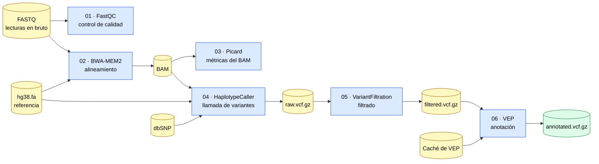

# Detección de variantes germinales (SNVs e INDELs) en genoma completo (WGS)

[](https://www.ncbi.nlm.nih.gov/datasets/genome/GCF_000001405.26/)
[](data/)

[](https://docs.conda.io/en/latest/)
[](scripts/)

[](LICENSE)

Este repositorio contiene un pipeline para la detección de variantes germinales de tipo SNV (*single nucleotide variants*) e INDEL (inserciones y deleciones) a partir de datos de secuenciación de genoma completo (WGS), utilizando como referencia el genoma humano hg38.

> [!WARNING]
> **Proyecto docente: simulación con fines exclusivamente académicos.**
>
> Este repositorio se ha creado para la asignatura _Introducción a la Programación Científica_ del Máster en Bioinformática de la UNIR, con el objetivo de practicar el uso de Git y GitHub. **No es un pipeline funcional ni validado.**
>
> Los scripts son esqueletos (pueden estar vacíos) y los resultados son ficheros de ejemplo. **No debe usarse para análisis científicos ni clínicos.**


## Objetivo

El objetivo del proyecto es, a partir de los ficheros FASTQ de cada muestra, obtener un fichero VCF con las variantes filtradas y anotadas.

## Pipeline

El pipeline consta de seis pasos, cada uno implementado en un script de la carpeta `scripts/`:

1. `01_fastq_qc.sh`: control de calidad de las lecturas en bruto (FastQC).
2. `02_alignment.sh`: alineamiento contra hg38 (BWA-MEM2).
3. `03_bam_qc.sh`: control de calidad del alineamiento (Picard).
4. `04_variant_calling.sh`: llamada de variantes (GATK HaplotypeCaller).
5. `05_variant_filtering.sh`: filtrado de variantes (GATK VariantFiltration).
6. `06_annotation.sh`: anotación de variantes (VEP).



## Estructura del repositorio

```
config/  # configuración del pipeline (config.yaml, samples.tsv)
data/    # datos de entrada: FASTQ (raw/) y referencia (reference/)
envs/    # entorno conda con las herramientas necesarias
results/ # resultados: control de calidad (qc/), BAM (bam/) y VCF (vcf/)
scripts/ # scripts de cada paso del pipeline
```

Cada carpeta contiene un README con la descripción de los ficheros que se encuentran en ella. Dado que los ficheros FASTQ, BAM y VCF ocupan varios GB por muestra, se han excluido del repositorio mediante el `.gitignore`.

## Instalación

### Requisitos

- [Conda](https://docs.conda.io/) (o [Miniconda](https://docs.conda.io/en/latest/miniconda.html))
- Sistema Linux (algunas herramientas, como BWA-MEM2, están pensadas para Linux x86_64 )
- Espacio en disco para la referencia, la caché de VEP y los resultados (varios GB por muestra)

### Pasos

1. Clona el repositorio:

   ```bash
   git clone https://github.com/<usuario>/wgs-germline-variant-calling-IPC-2026.git
   cd wgs-germline-variant-calling-IPC-2026
   ```

2. Crea el entorno con todas las herramientas:

   ```bash
   conda env create -f envs/environment.yml
   ```

3. Actívalo:

   ```bash
   conda activate wgs-germline-variant-calling
   ```

4. Comprueba que las herramientas están disponibles:

   ```bash
   fastqc --version
   bwa-mem2 version
   samtools --version
   gatk --version
   vep --help
   ```

## Preparación de los datos

Los datos no se incluyen en el repositorio (ver [`data/`](data/)). Antes de ejecutar el pipeline hay que:

1. Colocar los FASTQ de cada muestra en `data/raw/`.
2. Descargar el genoma hg38 en `data/reference/` y generar sus índices:

   ```bash
   samtools faidx data/reference/hg38.fa
   gatk CreateSequenceDictionary -R data/reference/hg38.fa
   bwa-mem2 index data/reference/hg38.fa
   ```

3. Descargar dbSNP y la caché de VEP en `data/reference/`:

   ```bash
   vep_install -a cf -s homo_sapiens -y GRCh38 -c data/reference/vep_cache
   ```
